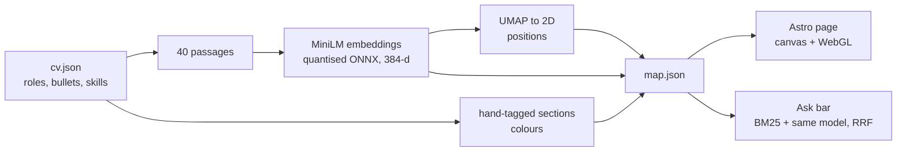

# sudomuhammad.github.io

My portfolio as an AI engineer: https://sudomuhammad.github.io/

The page is a map of my CV. Every bullet point is a sentence embedding, laid out so that similar work
sits together, and the story scrolls through it section by section. You can also ask it questions:
answers are quoted from the CV and searched entirely in your browser.

It's a small site, but it's built the way I build AI features: the model does the fuzzy part, code
does the parts that have to be right, and decisions are measured rather than assumed.

## How it works



- **Build time (Python, `ml/build_map.py`).** The CV is flattened into short passages, embedded with
  `all-MiniLM-L6-v2`, and placed with UMAP. The output, `src/data/map.json`, is committed; CI fails if it's
  stale.
- **One model, two places.** The browser loads the *same* quantised ONNX file at the same pinned commit
  through Transformers.js, so a visitor's question lands in the same vector space as the passages. It's
  fetched only when someone first asks a question; the first page load is about 200 KB.
- **Search is hybrid.** BM25 handles exact terms (a tool name), the embedding handles paraphrase
  ("how does the assistant remember earlier conversations?" finds the two bullets about memory and
  per-turn context, though neither says "remember"), and reciprocal-rank fusion merges them. A similarity
  floor means questions the CV can't answer get no answer rather than the nearest wrong one.
- **The page** is Astro with no UI framework. The particle physics is vanilla TypeScript on Canvas 2D,
  with a WebGL layer for the point cloud when available. Reduced motion gets a still render, and the
  canvas has a text equivalent on the page.

## Decisions, and the evidence for them

**Sections are tagged by hand, not clustered.** The first version coloured the map with HDBSCAN
clusters named from their top terms. With about 40 one-sentence passages it grouped them by shared
wording rather than by the work: a fleet-reporting system ended up under prompt engineering, and my
electrical engineering degree under data science. A quick check with larger embedding models didn't
recover sensible sections either. How the work should be filed is a judgement, so I make it in
`cv.json` and let the embeddings decide only where each point sits. A zero-shot check (each passage
against each section's description) agrees with my tags about 80% of the time with MiniLM, and its
disagreements were worth a second look.

**I kept the small model after measuring bigger ones.** `npm run eval` scores five small embedding
models on this CV exactly as the browser would run them, using 53 recruiter-style questions and 9 the
CV can't answer, written before any model was measured:

| Model | Download | Recall@3 | MRR | Separation |
|---|---|---|---|---|
| **MiniLM-L6 (in use)** | 23 MB | 0.77 | 0.71 | **0.97** |
| bge-small-en-v1.5 | 34 MB | 0.85 | 0.75 | 0.94 |
| gte-small | 34 MB | 0.83 | 0.75 | 0.94 |
| e5-small-v2 | 34 MB | **0.87** | 0.75 | 0.92 |

Newer models find the right passage more often, but they also confidently "answer" questions like
*Does he know Kubernetes?* or *Has he got a PhD?* from unrelated passages. On a page that promises
answers quoted from my CV, a confident wrong answer costs more than a missed paraphrase, and keyword
search recovers many of MiniLM's misses. Full results: [ml/eval/results.md](ml/eval/results.md).

**Labels are curated.** Only skills I list in `cv.json` are labelled on the map, each placed among the
evidence for it in its own section, so every label is in frame when the page zooms to that section.
A role's full tool list stays searchable but isn't drawn: lists of names pull the layout towards
shared tools rather than shared work.

## Run it

```sh
npm install
npm run dev        # http://localhost:4321
npm run build      # type-check and build the static site into dist/
npm test           # retrieval tests (vitest)
```

The map and evaluation need [uv](https://docs.astral.sh/uv/) and Python 3.12:

```sh
npm run map        # rebuild src/data/map.json after editing cv.json or themes.json
npm run test:ml    # pipeline tests and lint
npm run eval       # compare embedding models; writes ml/eval/results.md
```

## Layout

| Path | What's there |
|---|---|
| `src/data/cv.json` | Everything on the CV. Edit here, then `npm run map`. |
| `src/data/themes.json` | The five sections: name, summary, colour. |
| `src/data/copy.ts` | The page's own words (headings, intro, ask suggestions). |
| `src/data/story.ts` | The scroll story, derived once and shared by markup and scripts. |
| `src/scripts/map/` | Particle physics, camera, labels, WebGL point cloud. |
| `src/scripts/search/` | BM25, embeddings, fusion, and their tests. |
| `ml/` | The map pipeline, the model evaluation, and their tests. |

Pushing to `main` runs the checks and deploys to GitHub Pages (`.github/workflows/deploy.yml`).
